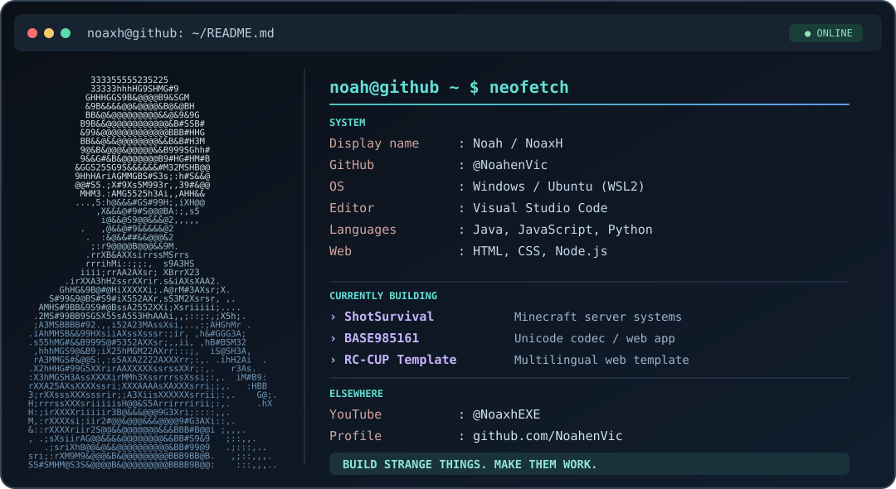

<div align="center">

# Noah / NoaxH

**Developer · Experimental software · Minecraft systems · Web experiences**



<br />

<a href="https://github.com/NoahenVic"></a>
<a href="https://www.youtube.com/@NoaxhEXE"></a>

</div>

### `noah@github:~$ whoami`

I build experimental software, unusual codecs and web products. I like turning strange ideas into practical tools, making systems work, and refining the details until they feel right.

### `noah@github:~$ ls projects/`

| Project | What it does |
| :--- | :--- |
| **[BASE985161](https://github.com/NoahenVic/BASE985161)** | Reversible binary-to-text codec using **985,161 Unicode symbols**, with Python and JavaScript implementations. |
| **[RC-CUP Template](https://github.com/NoahenVic/RC-CUP-Template)** | Customisable website template with JSON-managed content and multilingual support. |
| **[BASE262144](https://github.com/NoahenVic/BASE262144)** | Another experiment in unusual data representation. |
| **[ShotSurvival](https://www.shotsurvival.net)** | Custom Minecraft server systems and framework work. |

### `noah@github:~$ cat stack.txt`

<div align="left">


```text
Languages    Java · JavaScript · Python · HTML · CSS
Environment  Windows · Ubuntu / WSL2
Focus        Backend systems · Minecraft · Web · Experimentation
Workflow     idea → prototype → break things → refine → ship
```

</div>

### `noah@github:~$ git log --oneline`

I care about intentional interfaces, readable code, unusual ideas with working implementations, and the small details that make software feel polished.

<div align="center">

**[GitHub](https://github.com/NoahenVic)** · **[YouTube](https://www.youtube.com/@NoaxhEXE)** · **[Luau.Invincible](https://youtube.com/@luau.invincible)**

<sub>Build strange things. Make them work. Polish the result.</sub>

</div>
