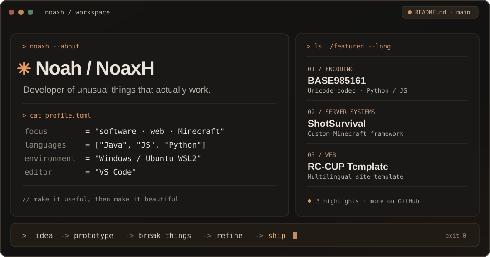

<div align="center">



<br />

<a href="https://github.com/NoahenVic"></a>
<a href="https://www.youtube.com/@NoaxhEXE"></a>

</div>

### `> whoami`

I'm **Noah**, also known as **NoaxH**. I build experimental software, Minecraft server systems, unusual codecs and websites that feel considered rather than thrown together.

I like ideas that sound slightly unreasonable, especially when I can make them work.

### `> ls ./projects --featured`

| Project | What it is |
| :--- | :--- |
| **[BASE985161](https://github.com/NoahenVic/BASE985161)** | A reversible binary-to-text codec built around **985,161 Unicode symbols**, with Python and JavaScript implementations. |
| **[RC-CUP Template](https://github.com/NoahenVic/RC-CUP-Template)** | A website template for competitive teams and communities, with JSON-managed content and multilingual support. |
| **[BASE262144](https://github.com/NoahenVic/BASE262144)** | Another experiment in encoding and data representation. |
| **[ShotSurvival](https://www.shotsurvival.net)** | Custom Minecraft server framework and systems development. |

### `> cat ~/stack.toml`

```toml
[languages]
main = ["Java", "JavaScript", "Python"]
web = ["HTML", "CSS", "Node.js"]

[environment]
os = "Windows + Ubuntu / WSL2"
editor = "Visual Studio Code"

[interests]
focus = ["Backend", "Minecraft", "Web", "Experiments"]
```

### `> cat ~/principles.md`

```text
01  Build things that actually work.
02  Keep the code understandable.
03  Care about the small details.
04  Experiment, break things, refine, ship.
```

<div align="center">

<sub><a href="https://github.com/NoahenVic">GitHub</a> · <a href="https://www.youtube.com/@NoaxhEXE">NoaxhEXE</a> · <a href="https://youtube.com/@luau.invincible">Luau.Invincible</a></sub>

</div>
